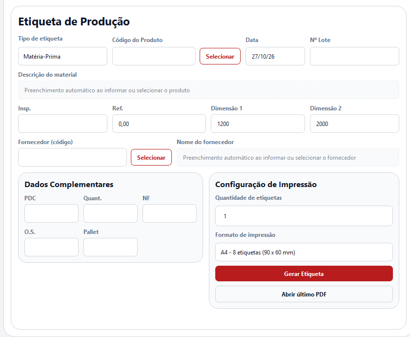
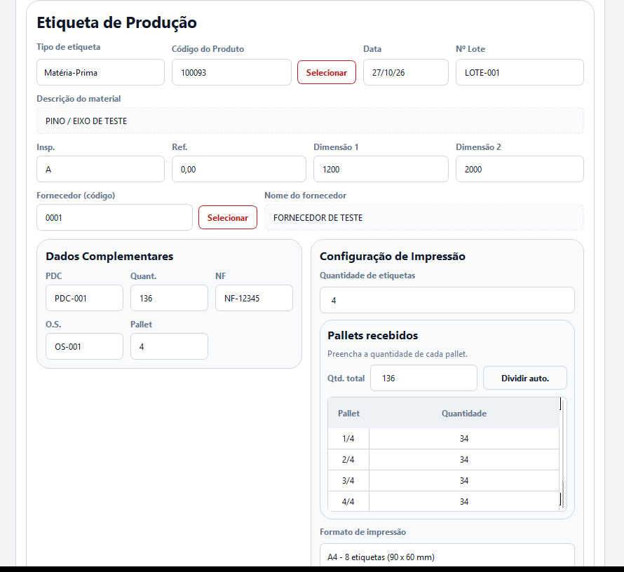
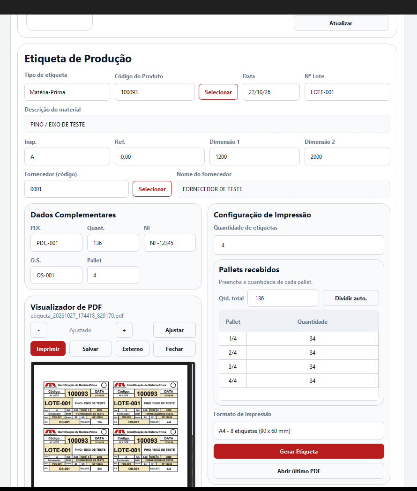
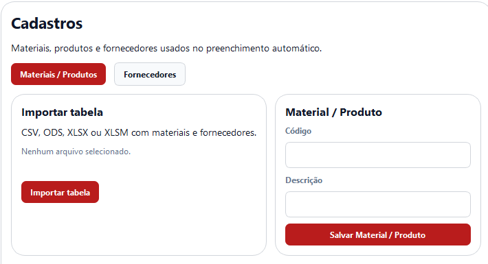

# Manual de uso — Almoxarifado Metalus

Este manual explica como abrir o aplicativo desktop, preencher e gerar etiquetas, consultar cadastros, importar planilhas e guardar os arquivos gerados. O programa funciona em uma janela própria no Windows e no Zorin OS.

As imagens mostram a interface do aplicativo. Os dados preenchidos nelas são exemplos.

## 1. Abrir o aplicativo

### Windows instalado

Abra **Almoxarifado** pelo menu Iniciar ou pelo atalho criado durante a instalação. O instalador já inclui os componentes necessários; não é preciso instalar Python.

### Windows portátil

Extraia a pasta portátil inteira e execute `INICIAR_ALMOXARIFADO.bat`. Não execute o programa de dentro do arquivo ZIP nem copie apenas o executável.

### Zorin OS

Instale o arquivo `.deb` com o APT e abra **Almoxarifado** pelo menu de aplicativos. Também é possível iniciar pelo terminal com:

```bash
almoxarifado
```

O pacote pode ser instalado para todas as contas do computador. Cada usuário mantém seus próprios cadastros.

## 2. Como os dados são guardados

O banco local guarda os cadastros de materiais/produtos e fornecedores. O instalador já traz uma lista inicial para facilitar o preenchimento.

As etiquetas geradas são arquivos PDF temporários. Para guardar uma etiqueta, clique em **Salvar** no visualizador e escolha onde gravar o PDF.

Os cadastros são locais: contas diferentes e instalações diferentes não sincronizam alterações automaticamente. A importação de uma planilha atualiza, no banco da conta atual, os registros que tenham o mesmo código.

## 3. Tela de geração de etiquetas



Na parte superior, informe os dados da etiqueta:

- **Tipo de etiqueta**: Matéria-Prima, Matéria-Prima Usinados ou Bens de Consumo.
- **Código do Produto**: código do material; use **Selecionar** para pesquisar no cadastro.
- **Data** e **Nº Lote**: informações do recebimento.
- **Descrição do material**: pode ser preenchida automaticamente ao informar ou selecionar um código cadastrado.
- **Insp.**, **Ref.**, **Dimensão 1** e **Dimensão 2**: informações técnicas que devem sair na etiqueta.
- **Fornecedor (código)**: código do fornecedor; use **Selecionar** para pesquisar.
- **Nome do fornecedor**: pode ser preenchido automaticamente quando o fornecedor está cadastrado.
- **PDC**, **Quant.**, **NF**, **O.S.** e **Pallet**: dados complementares.

O campo **Código do Produto** é obrigatório. Os demais dados devem ser preenchidos conforme a etiqueta e o processo da empresa. Pressionar **Enter** em um campo avança para o próximo.

## 4. Pesquisar materiais e fornecedores

1. Clique em **Selecionar** ao lado do código do produto ou do fornecedor.
2. Na janela de pesquisa, digite parte do código ou da descrição/nome e clique em **Buscar**.
3. Use **Anterior** e **Próxima** para percorrer os resultados, se necessário.
4. Selecione o registro desejado.

Quando o código está cadastrado, a descrição do material ou o nome do fornecedor é preenchido automaticamente.

## 5. Gerar uma etiqueta

1. Escolha o **Tipo de etiqueta**.
2. Preencha o código do produto e os dados que devem constar na etiqueta.
3. Para uma etiqueta simples, deixe **Quantidade de etiquetas** em `1` e informe **Pallet** como `1` ou deixe-o vazio.
4. Escolha o **Formato de impressão**.
5. Clique em **Gerar Etiqueta**.
6. Confira o PDF no visualizador integrado.
7. Clique em **Imprimir** para enviar à impressora ou em **Salvar** para guardar uma cópia.

## 6. Dividir uma quantidade entre pallets

Use este recurso quando a quantidade total do material estiver distribuída em mais de um pallet.



1. Informe a quantidade total em **Quant.**.
2. Informe o número de pallets em **Pallet**. O campo **Quantidade de etiquetas** acompanha esse número.
3. A tabela **Pallets recebidos** aparece. Confira o total em **Qtd. total**.
4. Para dividir igualmente, clique em **Dividir auto.**. Você também pode preencher ou ajustar cada quantidade na tabela.
5. Confira a soma e clique em **Gerar Etiqueta**.

Cada linha da tabela corresponde a um pallet e resulta em uma etiqueta identificada, por exemplo, como `1/3`, `2/3` e `3/3`. A soma das quantidades da tabela precisa ser igual à quantidade total; cada pallet precisa ter pelo menos uma unidade.

Na divisão automática, a sobra da divisão é distribuída começando pelos primeiros pallets. Por exemplo, `10` unidades em `3` pallets resulta em `4`, `3` e `3`.

As quantidades precisam ser números inteiros positivos. É permitido usar ponto como separador de milhares (`1.000` significa mil); decimais, valores negativos e vírgula como separador não são aceitos.

## 7. Formatos de impressão

Os formatos disponíveis são:

- **A4 - 8 etiquetas (90 x 60 mm)**: folha A4 com até oito etiquetas por página.
- **Etiqueta 100 x 70 mm**: página individual para impressão em etiqueta desse formato.

As opções estão disponíveis para os três tipos de etiqueta. Confirme se o papel e a escala selecionados nas configurações da impressora correspondem ao formato escolhido.

## 8. Visualizar, imprimir e salvar o PDF



O PDF é exibido na própria tela do aplicativo. Os controles são:

- **-** e **+**: diminuir ou aumentar o zoom.
- **Ajustar**: ajustar a visualização à largura disponível.
- **Imprimir**: abrir as opções de impressão do sistema.
- **Salvar**: escolher a pasta e o nome do arquivo PDF.
- **Externo**: abrir o PDF no leitor padrão do computador.
- **Fechar**: ocultar o visualizador e voltar ao formulário.

## 9. Abrir o último PDF

**Abrir último PDF** reabre o arquivo gerado mais recentemente durante a sessão atual. Se ainda não houver etiqueta gerada nessa sessão, o aplicativo avisará que é preciso gerar uma primeiro.

Os PDFs temporários podem ser removidos quando o aplicativo é fechado. Use **Salvar** para manter uma cópia.

## 10. Começar uma nova etiqueta

Clique em **Atualizar** no cabeçalho do formulário. O aplicativo limpa os campos, fecha a visualização atual e volta para os valores iniciais, incluindo a data atual.

## 11. Tela de cadastros

Clique no cartão **Cadastros** no cabeçalho. A tela contém as áreas de importação, edição e pesquisa:



- Use **Materiais / Produtos** ou **Fornecedores** para alternar entre os cadastros.
- O formulário à direita permite cadastrar ou atualizar um registro.
- A lista abaixo permite pesquisar por código/descrição ou nome. Um duplo clique em uma linha carrega o registro no formulário de edição.
- Clique em **Atualizar** para recarregar a lista; **← Almoxarifado** retorna à geração de etiquetas.

## 12. Importar uma planilha


1. Abra **Cadastros**.
2. Confirme que a planilha tem uma linha de cabeçalho com colunas de código e descrição/nome.
3. Clique em **Importar tabela** e selecione o arquivo.
4. Aguarde o processamento e confira o resultado exibido na tela.

São aceitos arquivos **CSV**, **ODS**, **XLSX** e **XLSM**. Para materiais, use colunas equivalentes a código do material/produto e descrição. Para fornecedores, use código do fornecedor e nome/razão social. Os nomes dos cabeçalhos podem variar, por exemplo: `codigo_material`, `codigo_produto`, `descricao_material`, `codigo_fornecedor` e `nome_fornecedor`.

Registros com código já cadastrado são atualizados com os dados da planilha. Linhas sem dados reconhecidos de material ou fornecedor são ignoradas; a mensagem de conclusão informa os resultados.

## 13. Cadastrar ou atualizar manualmente

### Material ou produto

1. Em **Cadastros**, selecione **Materiais / Produtos**.
2. Informe **Código** e **Descrição**.
3. Clique em **Salvar Material / Produto**.

### Fornecedor

1. Em **Cadastros**, selecione **Fornecedores**.
2. Informe **Código** e **Nome**.
3. Clique em **Salvar Fornecedor**.

O código identifica o registro. Se já existir, salvar novamente atualiza a descrição ou o nome.

## 14. Fazer backup dos cadastros

Inclua o banco local nos backups para preservar os registros:

- **Windows instalado**: `%LOCALAPPDATA%\Almoxarifado`.
- **Windows portátil**: pasta `data` junto ao aplicativo.
- **Zorin OS**: `$XDG_DATA_HOME/Almoxarifado`, se a variável estiver definida; caso contrário, `~/.local/share/Almoxarifado`.

No Zorin, o aplicativo fica disponível para as contas do computador, mas cada conta tem seu próprio banco. Para levar cadastros para outra conta ou computador, faça uma cópia de segurança ou use **Importar tabela**. Os cadastros de Windows e Linux não são sincronizados automaticamente.

## 15. Problemas comuns

### A descrição do material ou o nome do fornecedor não é preenchido

Verifique se o código está correto e se o registro existe na aba correspondente de **Cadastros**. Use **Atualizar** na tela de cadastros ou importe a planilha atualizada.

### A geração de etiquetas para pallets mostra um aviso

Confirme se há uma quantidade total válida, se todos os pallets têm quantidade maior que zero e se a soma da tabela é igual ao total informado.

### O PDF não aparece ou não abre externamente

Gere a etiqueta novamente. Se **Externo** não abrir o arquivo, confira se há um leitor de PDF padrão instalado. Também é possível imprimir ou salvar pelo visualizador integrado.

### A impressão saiu cortada ou em escala incorreta

Confirme o formato escolhido, o papel carregado e a escala nas opções da impressora. Para preservar as dimensões, use tamanho real/100% quando essa opção estiver disponível.

### O aplicativo não abre em outra conta do Zorin

Instale o pacote `.deb` atualizado pelo APT para que o programa e o atalho estejam disponíveis no computador. Cada conta usa seus próprios dados. Para ver uma mensagem de erro, abra um terminal nessa conta e execute `almoxarifado`.

## 16. Ajustar a janela à tela

O aplicativo funciona em janela própria. Redimensione a janela conforme necessário; em telas menores, role a página para acessar todos os campos e botões.
